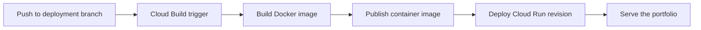

# Gerald Shin — Personal Portfolio

A personal résumé and portfolio website presenting my work in analytics engineering, data platforms, and engineering leadership. Built with Django and Python, containerized with Docker, and hosted on Google Cloud Run. This repository includes a Cloud Build pipeline for automated deployment.

**[Visit geraldshin.com](https://geraldshin.com)** · [LinkedIn](https://www.linkedin.com/in/geraldshin/) · [GitHub](https://github.com/GeraldShin)

## How the website was built

The site started as a Django application with résumé content stored in JSON. That keeps experience, skills, and projects easy to update without adding a database-backed content management system or a separate frontend application.

The design evolved into a responsive portfolio with a personal portrait, warm ivory and green colors, clear typography, and a career-focused layout. Experience entries and technical skills use native HTML disclosure elements, while a small JavaScript module handles light and dark themes. The layout was reviewed in desktop and mobile browsers.

The current version includes:

- A professional introduction highlighting 10+ years of experience.
- Expandable career history, including analytics engineering leadership at Prime Therapeutics.
- Technical expertise and engineering leadership practices.
- A project section describing this portfolio.
- A downloadable PDF résumé and direct contact links.
- Responsive layouts, keyboard focus states, a skip link, and reduced-motion support.

## Technology

| Layer | Implementation |
| --- | --- |
| Application | Python and Django |
| Content | JSON loaded by the portfolio view |
| Frontend | Django templates, custom CSS, and vanilla JavaScript |
| Static assets | Django static files and WhiteNoise |
| Application server | Gunicorn |
| Container | Docker, based on Python 3.12 slim |
| CI/CD | Google Cloud Build |
| Hosting | Google Cloud Run |
| Source control | GitHub |

The public portfolio reads its content from JSON. Django models, the admin route, and SQLite configuration remain in the project, but the homepage's résumé content does not depend on database records.

## Run locally

Use Python 3.12 or newer. From a terminal:

```bash
git clone https://github.com/GeraldShin/Django-Resume-Website.git
cd Django-Resume-Website
python -m venv .venv
```

Activate the environment on Windows PowerShell:

```powershell
.\.venv\Scripts\Activate.ps1
```

Or on macOS/Linux:

```bash
source .venv/bin/activate
```

Install dependencies and start Django:

```bash
python -m pip install -r requirements.txt
python manage.py migrate
python manage.py check
python manage.py runserver 127.0.0.1:8017
```

Open [localhost:8017](http://localhost:8017). The Django development server is for local development; the deployed container uses Gunicorn.

## Project structure

```text
portfolio/
├── data/resume_data.json       # Experience, skills, and projects
├── templates/portfolio/
│   └── home.html               # Page structure and introduction
├── static/
│   ├── css/portfolio.css       # Responsive layout and themes
│   ├── js/portfolio.js         # Theme preference handling
│   ├── images/                 # Portrait and image assets
│   └── files/                  # Downloadable résumé
├── urls.py                     # Portfolio routes
└── views.py                    # Loads JSON and renders the homepage
resume_site/                    # Django settings and application entry points
Dockerfile                      # Container build and Gunicorn startup
cloudbuild.yaml                 # Build, check, push, and Cloud Run deployment
manage.py                       # Django management commands
requirements.txt                # Pinned Python dependencies
```

## Updating the website

- **Experience, skills, and projects:** edit `portfolio/data/resume_data.json`.
- **Introduction, contact links, and page structure:** edit `portfolio/templates/portfolio/home.html`.
- **Layout and colors:** edit `portfolio/static/css/portfolio.css`.
- **Portrait:** add the image under `portfolio/static/images/` and update its template reference.
- **Résumé download:** add the PDF under `portfolio/static/files/` and update both download links in the template.

After making changes, run `python manage.py check`, review the page at desktop and mobile widths, and verify navigation, expandable content, theme switching, and the résumé download.

## Deployment with Cloud Build and Cloud Run

The pipeline in `cloudbuild.yaml` builds and checks the application container, publishes it, and deploys it to the existing Cloud Run service. The `resumewebsite-master` GitHub push trigger runs this pipeline for commits to `master`.



1. A push to the branch matched by the Cloud Build trigger starts the pipeline.
2. The container build uses the root `Dockerfile`, installs `requirements.txt`, copies the application, and runs `python manage.py collectstatic --noinput`.
3. The pipeline publishes the image to its configured container registry and deploys it as a Cloud Run revision.
4. Gunicorn runs `resume_site.wsgi:application` with two workers and binds to the `PORT` supplied by Cloud Run.

### Pipeline configuration

- **Google Cloud project:** `project-219dfe0a-9cad-4fc8-bb9` (Django Resume Website)
- **Cloud Run service:** `resumewebsite`, region `us-east1`
- **Repository:** `GeraldShin/Django-Resume-Website`
- **Trigger branch filter:** `^master$`
- **Build configuration:** `cloudbuild.yaml`
- **Image:** `gcr.io/$PROJECT_ID/resumewebsite:$BUILD_ID`
- **Build service account:** `1069157667401-compute@developer.gserviceaccount.com`

The configuration uses a unique build ID for each image, runs Django's system check before pushing it, and sends build logs to Cloud Logging. Deployment updates the existing service without changing its public access policy.

### Connected GitHub trigger

The `resumewebsite-master` trigger is configured in `us-east1` for `GeraldShin/Django-Resume-Website`, with the branch filter `^master$` and build configuration `cloudbuild.yaml`.

The existing build account has Cloud Run Developer on the `resumewebsite` service and Service Account User on the existing runtime account. This allows the pipeline to update the service without changing its public access policy.

If automation stops, check the repository connection and branch filter first, then inspect build history and the build account's deployment permissions. The Cloud Build project is the **Django Resume Website** project listed above, which may differ from the active project in a local gcloud configuration.

The pipeline was repaired on October 28, 2026 after Cloud Build reported a missing GitHub repository mapping. Earlier builds used uploaded source archives.

To review a release, inspect the triggered build in **Cloud Build → History**, then check the revision's readiness and traffic assignment in **Cloud Run**. A successful Git push alone does not confirm a successful deployment.

Google's [continuous deployment guide](https://docs.cloud.google.com/run/docs/continuous-deployment) explains the repository connection and trigger setup. The [Cloud Build deployment guide](https://docs.cloud.google.com/build/docs/deploying-builds/deploy-cloud-run) covers building, publishing, and deploying a container image.

## Contact

I'm Gerald Shin, an analytics engineering leader focused on scalable data platforms, modernizing analytics workflows, and developing engineering teams.

- **Website:** [geraldshin.com](https://geraldshin.com)
- **Email:** [GeraldHShin@gmail.com](mailto:GeraldHShin@gmail.com)
- **LinkedIn:** [linkedin.com/in/geraldshin](https://www.linkedin.com/in/geraldshin/)
- **GitHub:** [github.com/GeraldShin](https://github.com/GeraldShin)

Feel free to reach out about analytics engineering, data platforms, engineering leadership, or collaboration.
